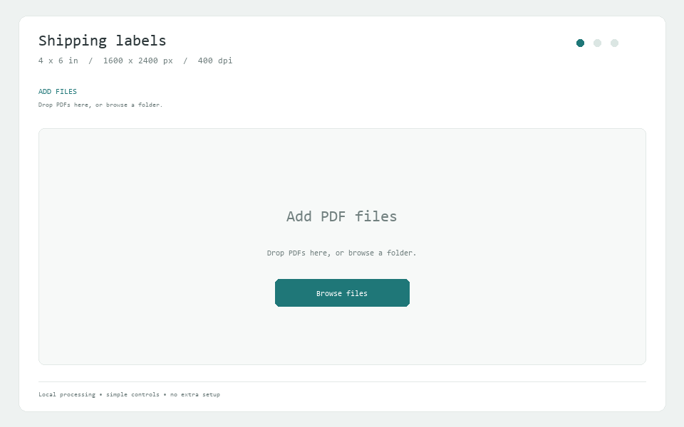

# ParcelCrop

**简洁地把 PDF 面单裁成 4×6 英寸 JPG。**

[下载最新版](https://github.com/ArdeaNew/parcelcrop-4x6/releases/latest) · [English](README.en.md) · [使用指南](docs/USER_GUIDE.md) · [更新记录](CHANGELOG.md)

ParcelCrop 是一个轻量的 Windows 面单裁切工具：把单页 PDF 拖进窗口，确认预览后点击一次 **Process all**，JPG 就会保存到原文件夹。文件在本地处理，无需配置额外服务。对从 Amazon 等平台下载的 UPS、FedEx 等主流面单，单页 A4 PDF 的有效区域通常位于左上角，导入后会自动检测并预览该区域。

## 三步完成

1. **添加**：点击 **Add files**，或直接把多个 PDF 拖入窗口。
2. **确认**：查看自动裁切预览；需要时拖动裁切框，点击 **Detect** 或 **Rotate**。
3. **导出**：点击 **Process all**，在原 PDF 文件夹中得到对应的 JPG。

## 主要功能

- 批量导入单页 PDF，自动检测面单内容范围。
- 预览裁切结果，按需移动、等比调整或旋转 90°。
- 输出统一的 4×6 英寸 JPG，内容保持比例并居中留白。
- 默认保留原 PDF，可在成功导出后移入回收站。
- 本地处理，支持移除任务、批量导出和失败后重试。

## 输出规格

- 1600×2400 像素，400 DPI，4×6 英寸，宽高比 2:3。
- 裁切内容等比缩放并居中，白色背景，JPEG 质量 95。
- 2:3 是输出画布比例，内容不会被拉伸；已有同名 JPG 不会被覆盖。

## 快速开始

运行环境：Windows 64 位、.NET Framework 4.8。

1. 从 [Releases](https://github.com/ArdeaNew/parcelcrop-4x6/releases/latest) 下载名称以 `win-x64.zip` 结尾的便携包，并完整解压。
2. 打开解压后的 `ParcelCrop.exe`。便携包已包含 PDF 处理组件，无需另行配置。
3. 添加 PDF，检查预览，然后点击 **Process all**。

每个输入 PDF 仅支持一页。完整操作说明见[使用指南](docs/USER_GUIDE.md)。

## 许可

本项目采用 [AGPL-3.0-or-later](LICENSE)。随包组件的许可、版权和对应源码见[第三方声明](THIRD_PARTY_NOTICES.md)。
